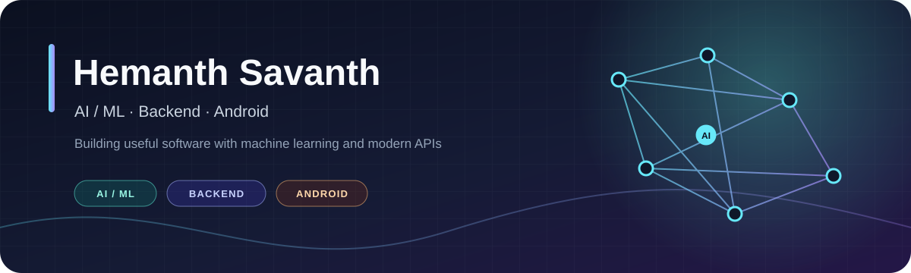
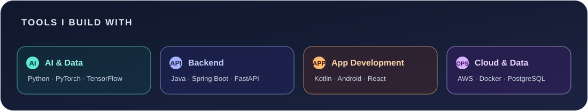

Computer Science graduate from MVJ College of Engineering. I build practical AI, backend, and mobile applications with Python, Java, Kotlin, and modern AI tools.

## About

- Software Development Intern at MindMatrix, where I built Android apps using Google Gemini.
- Interested in AI/ML, LLM applications, backend systems, and mobile development.
- IEEE Xplore author on phishing detection and prevention.

## Featured Projects

- [ALSA - Acute Leukemia Subtype Analyzer](https://github.com/AlphaDoc1/ALSA-Acute-Leukemia-Subtype-Analyzer): EfficientNet-B0 trained on more than 10,000 blood-cell images; 96.3% accuracy and 0.97 AUC for ALL vs. HEM. Includes Grad-CAM explanations and a Hugging Face Spaces deployment.
- [PrathamChikitse](https://github.com/AlphaDoc1/PrathamChikitse): Offline-first Kannada and English first-aid Android app for rural communities.
- [AI Interview Coach](https://github.com/AlphaDoc1/AI-Interview-Coach-app): Android app with voice questions and AI-powered interview feedback.
- [YouTube Video Summarizer](https://github.com/AlphaDoc1/YouTube-Video-Summarizer-app): Android app that uses LLMs to summarize YouTube videos.
- [Phishing Detection](https://github.com/AlphaDoc1/phishing): Browser extension and mobile app research published in IEEE Xplore; false-positive rate below 2% across 5,000 URLs.

## Toolkit

Python, Java, Kotlin, TypeScript, JavaScript, Spring Boot, FastAPI, React, Next.js, PostgreSQL, MongoDB, AWS, Docker, PyTorch, TensorFlow, Gemini, and LLM applications.

## Connect

[Email](mailto:savanthhemanth@gmail.com) · [LinkedIn](https://www.linkedin.com/in/hemanth-savanth-48546835a) · [Portfolio](https://hemanthsavanthpro.vercel.app/)
